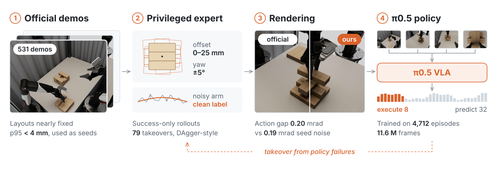

<h1 align="center">TOWER Jenga</h1>

<p align="center">
  A π0.5 policy for bimanual Jenga, distilled from a privileged expert<br>
  <sub>Team wzyfromhust · CoRL 2026 TOWER Challenge</sub>
</p>

<p align="center">
  <a href="https://huggingface.co/zhiyaowang/tower-jenga-pi05-v3">Weights</a> ·
  <a href="docs/method.md">Method</a> ·
  <a href="docs/training.md">Training</a> ·
  <a href="docs/results.md">Results</a> ·
  <a href="README.zh.md">中文</a>
</p>

<p align="center">
  
</p>

## Overview

The official demonstrations start from almost the same layout every time, and a policy cloned from them fails as
soon as a block is displaced. We therefore use them only as seeds. A privileged expert re-solves every task from
perturbed layouts in a local reconstruction of the simulator. Its successful rollouts are rendered in the dataset
format, and π0.5 is fine-tuned on them alone.

- **Data.** 4,712 synthetic episodes (11.6 M frames). Layouts are offset by up to 25 mm and 5°, and joint noise is
  injected so that the labels teach the policy to correct itself.
- **Model.** π0.5 base (3.35 B parameters), fully fine-tuned on four cameras. The policy predicts 32 joint-delta
  actions at 30 Hz, of which the server executes 8.
- **Compute.** Two stages, 28,000 steps in total, on 8 H800 GPUs for about 25 GPU-hours.

## Results

Final official scores (10 episodes per variant):

| Variant | TSR | LHPR | ODR ↓ | Task score |
|:--|--:|--:|--:|--:|
| task1-2 · tower transfer | 100.0% | 100.0% | 0.000 | 100.00 |
| task1-3 · tower transfer | 100.0% | 100.0% | 0.000 | 100.00 |
| task2-2 · cross-tower transfer | 90.0% | 92.5% | 0.026 | 91.43 |
| task2-3 · cross-tower transfer | 100.0% | 100.0% | 0.000 | 100.00 |
| task3-2 · vertical stacking | 100.0% | 100.0% | 0.000 | 100.00 |
| task3-3 · vertical stacking | 100.0% | 100.0% | 0.117 | 98.96 |
| task4-2 · full-tower push-down | 50.0% | 83.3% | 0.509 | 69.79 |
| task4-3 · full-tower push-down | 30.0% | 71.1% | 1.197 | 54.28 |
| task5-2 · tower insertion | 0.0% | 50.0% | 2.300 | 31.01 |
| task5-3 · tower insertion | 0.0% | 35.0% | 1.917 | 21.80 |

TSR is the share of fully successful episodes. LHPR is the share of planned grasp and place operations completed.
ODR counts disturbed non-target blocks per step and can exceed 1. Weighted 1:1:1:3:3 by task family, the scores sum
to 62.28 of 100; this total is our own arithmetic.

Tasks 1 to 3 are essentially solved. The push-down and insertion tasks are not, even though our local simulator
rates them far higher. [docs/results.md](docs/results.md) compares official and local numbers and analyses the
failures.

## Quick start

Requires Linux, an NVIDIA GPU and [uv](https://docs.astral.sh/uv/). We measured on H800 80 GB.

```bash
git clone https://github.com/zywang-hust/tower-jenga && cd tower-jenga
bash scripts/bootstrap.sh                 # OpenPI 215abfb + our patch, into .venv
source .venv/bin/activate

hf download zhiyaowang/tower-jenga-pi05-v3 --local-dir models/tower-jenga-pi05-v3

python scripts/serve_policy.py \
    --track configs/track_20261013-v1-task45-30hz.json \
    --params models/tower-jenga-pi05-v3 \
    --start-qpos configs/start_qpos.json \
    --policy-id distill-v3-28000-home --devices 0
```

The server speaks the challenge protocol `tower-infer-v1` on 127.0.0.1:9001 and prints `SERVER_READY` once
compiled. A forward pass takes 48 ms (median) on H800. `scripts/replay_client.py` replays dataset frames against
the server to check the protocol without a simulator.

<details>
<summary>Local closed-loop evaluation</summary>

This needs the dataset, the station assets, Isaac Sim 5.1, a second Python environment for the renderer and a
trained refinement network, which is not released ([docs/training.md](docs/training.md#3-renderer-refinement-network)
describes how to train it).

```bash
# one line per episode: <demo.hdf5> [dx dy dpsi]  (layout offset in m and rad); seed 0
scripts/fleet.sh models/tower-jenga-pi05-v3 jenga-v3 episodes_t14.txt runs/fleet/v3_t14_r0 48 0
JENGA_PHYS_FIDELITY=1 scripts/fleet.sh models/tower-jenga-pi05-v3 jenga-v3 episodes_t5.txt runs/fleet/v3_t5_r0 48 0
python3 scripts/final_table.py runs/fleet    # mean LHPR per variant
```

</details>

## How it works

**Seeds, not samples.** The 531 demonstrations of Tower-SimData vary by less than 4 mm (p95) in layout and never in
yaw. They supply the train split, the normalization statistics and the initial layouts; their frames are never
trained on.

**An expert that produces corrections.** The expert reads true block poses and replans from the measured state.
During transit we perturb the executed motion while keeping the expert's absolute targets as labels, so the data
show a displaced arm being pulled back. 79 episodes start from failure states of earlier policies, a DAgger-style
loop. Only rollouts in which every operation succeeds are kept.

**A simulator matched to the evaluator.** Physics runs in Isaac Sim PhysX with parameters read from the dataset
files; replayed commands reproduce the recorded joint trajectories within 0.5 mrad. Frames are rasterized and then
refined by a network trained on official images. Swapping an official frame for our render moves the policy's
actions by 0.20 mrad, about the same as changing the sampling seed (0.19 mrad).

**Two serving-time measures.** If a trial starts away from the training start pose (task1-2, 165 mrad), the server
first moves the arms there (a 1 s ramp and a 0.5 s hold). It also checks once per trial whether the external cameras arrive
rotated by 180°.

The full account, with the evidence for each choice, is in [docs/method.md](docs/method.md). Commands and
per-batch settings for reproducing training are in [docs/training.md](docs/training.md); the data are not released.

## Limitations

- **Insertion.** The slot leaves about 1 mm of clearance per side. Millimetre-level entry errors are not recovered,
  and no task5 episode succeeded.
- **Push-down.** Our physics diverges once a pushed block tumbles, so the task4 failures cannot be reproduced locally.
- **Sim only.** The policy has seen only our renders and has never run on hardware. Homing covers the start poses
  of the official track and no others.

## Repository

```text
src/jenga/   data pipeline, action representation, model, serving (chunking, homing, camera check)
sim/         local simulator (Isaac PhysX, rasterizer + refinement), privileged expert, data writers
scripts/     entry points for data preparation, training, serving and closed-loop evaluation
configs/     challenge track, cameras, kinematics, start poses, synthetic file lists
docs/        method, training, results; Chinese working notes from the challenge
```

Data and models are looked up under `data/tower` and `models/`; `JENGA_DATA_ROOT` and `JENGA_MODELS` override them.
The Chinese notes in `docs/` are the logs we kept during the challenge and include abandoned experiments.

## Citation

```bibtex
@misc{wzyfromhust2026towerjenga,
  title        = {{TOWER} {Jenga}: a $\pi_{0.5}$ policy distilled from a privileged expert},
  author       = {{Team wzyfromhust}},
  year         = {2026},
  howpublished = {\url{https://github.com/zywang-hust/tower-jenga}},
  note         = {CoRL 2026 TOWER challenge entry}
}
```

Please also cite [π0.5](https://arxiv.org/abs/2504.16054) and
[Tower-SimData](https://huggingface.co/datasets/tower-benchmark/TOWER-SimData).

## Acknowledgements and license

We thank the TOWER organizers for the benchmark, the evaluation service and the leaderboard. The model builds on
[OpenPI](https://github.com/Physical-Intelligence/openpi) and the π0.5 base checkpoint from Physical Intelligence;
physics runs on NVIDIA Isaac Sim and the rasterizer uses nvdiffrast.

- **Code:** [Apache-2.0](LICENSE), including the patch against OpenPI ([NOTICE](NOTICE)).
- **Weights:** a Gemma model derivative, distributed under the [Gemma Terms of Use](https://ai.google.dev/gemma/terms)
  with their NOTICE on Hugging Face.
- **Data and assets** derived from [Tower-SimData](https://huggingface.co/datasets/tower-benchmark/TOWER-SimData) and
  [TOWER-Assets](https://huggingface.co/datasets/tower-benchmark/TOWER-Assets): CC BY 4.0.
