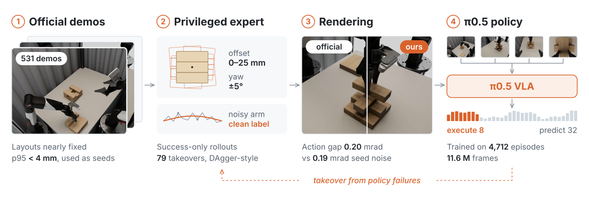

<h1 align="center">TOWER Jenga</h1>

<p align="center">
  从特权专家蒸馏得到的双臂 Jenga π0.5 策略<br>
  <sub>wzyfromhust 队 · CoRL 2026 TOWER 挑战赛</sub>
</p>

<p align="center">
  <a href="https://huggingface.co/zhiyaowang/tower-jenga-pi05-v3">权重</a> ·
  <a href="docs/method.md">方法</a> ·
  <a href="docs/training.md">训练</a> ·
  <a href="docs/results.md">结果</a> ·
  <a href="README.md">English</a>
</p>

<p align="center">
  
</p>

## 概览

官方示教几乎每次都从同一个布局开始，直接克隆的策略在积木稍有偏移时就会失败，所以我们只把示教当作种子。特权专家在
本地复现的仿真器里，从扰动后的布局重新完成每个任务；成功的轨迹渲染成数据集格式，π0.5 只在这些数据上微调。

- **数据**：4,712 条合成 episode，1,160 万帧。布局最多偏移 25 mm、5°，并注入关节噪声，让标签教会策略自我纠正。
- **模型**：π0.5 base（33.5 亿参数），四路相机，全参数微调。策略以 30 Hz 预测 32 步关节增量，服务端执行其中 8 步。
- **算力**：两阶段共 28,000 步，8 张 H800，约 25 GPU 小时。

## 结果

官方最终成绩（每个变体 10 个 episode）：

| 变体 | TSR | LHPR | ODR ↓ | 任务得分 |
|:--|--:|--:|--:|--:|
| task1-2 · 塔转移 | 100.0% | 100.0% | 0.000 | 100.00 |
| task1-3 · 塔转移 | 100.0% | 100.0% | 0.000 | 100.00 |
| task2-2 · 跨塔转移 | 90.0% | 92.5% | 0.026 | 91.43 |
| task2-3 · 跨塔转移 | 100.0% | 100.0% | 0.000 | 100.00 |
| task3-2 · 垂直堆叠 | 100.0% | 100.0% | 0.000 | 100.00 |
| task3-3 · 垂直堆叠 | 100.0% | 100.0% | 0.117 | 98.96 |
| task4-2 · 整塔推倒 | 50.0% | 83.3% | 0.509 | 69.79 |
| task4-3 · 整塔推倒 | 30.0% | 71.1% | 1.197 | 54.28 |
| task5-2 · 塔插入 | 0.0% | 50.0% | 2.300 | 31.01 |
| task5-3 · 塔插入 | 0.0% | 35.0% | 1.917 | 21.80 |

TSR 是完全成功的 episode 比例；LHPR 是完成的抓取和放置操作占计划操作的比例；ODR 是每步被扰动的非目标积木数，可以
大于 1。按任务族 1:1:1:3:3 加权，总分为 62.28（满分 100），这是我们自己的计算。

任务 1 到 3 基本解决。推倒和插入没有解决，尽管本地仿真给它们的分数高得多。官方与本地的对比和失败分析见
[docs/results.md](docs/results.md)。

## 快速上手

需要 Linux、NVIDIA GPU 和 [uv](https://docs.astral.sh/uv/)。我们的测量都在 H800 80 GB 上完成。

```bash
git clone https://github.com/zywang-hust/tower-jenga && cd tower-jenga
bash scripts/bootstrap.sh                 # OpenPI 215abfb 加我们的补丁，装进 .venv
source .venv/bin/activate

hf download zhiyaowang/tower-jenga-pi05-v3 --local-dir models/tower-jenga-pi05-v3

python scripts/serve_policy.py \
    --track configs/track_20261013-v1-task45-30hz.json \
    --params models/tower-jenga-pi05-v3 \
    --start-qpos configs/start_qpos.json \
    --policy-id distill-v3-28000-home --devices 0
```

服务在 127.0.0.1:9001 上使用挑战赛协议 `tower-infer-v1`，编译完成后打印 `SERVER_READY`。H800 上一次前向的中位耗时
是 48 ms。`scripts/replay_client.py` 把数据集帧回放给服务，不需要仿真器就能检查协议。

<details>
<summary>本地闭环评测</summary>

需要数据集、工位资产、Isaac Sim 5.1、渲染器用的第二个 Python 环境，以及训练好的精修网络（未发布，训练方法见
[docs/training.md](docs/training.md#3-renderer-refinement-network)）。

```bash
# 每行一个 episode：<demo.hdf5> [dx dy dpsi]（布局偏移，单位 m 和 rad）；种子 0
scripts/fleet.sh models/tower-jenga-pi05-v3 jenga-v3 episodes_t14.txt runs/fleet/v3_t14_r0 48 0
JENGA_PHYS_FIDELITY=1 scripts/fleet.sh models/tower-jenga-pi05-v3 jenga-v3 episodes_t5.txt runs/fleet/v3_t5_r0 48 0
python3 scripts/final_table.py runs/fleet    # 各变体平均 LHPR
```

</details>

## 工作原理

**示教只作种子。** Tower-SimData 的 531 条示教布局差异不到 4 mm（p95），偏航从不变化。它们提供训练集划分、归一化
统计量和初始布局，帧本身不参与训练。

**能产生纠正的专家。** 专家读取积木真实位姿，并从测得的状态重新规划。转运时我们扰动实际执行的动作，标签仍取专家的
绝对目标，于是数据里出现了偏离的手臂被拉回的过程。另有 79 个 episode 从早期策略的失败状态开始，构成类似 DAgger 的
闭环。只保留每个操作都成功的轨迹。

**向评测端对齐的仿真器。** 物理用 Isaac Sim PhysX，参数取自数据集文件；回放录制的指令，关节轨迹误差在 0.5 mrad 以内。
画面先光栅化，再由一个用官方图像训练的网络精修。把官方帧换成我们的渲染，策略动作变化 0.20 mrad，与换一个采样种子
（0.19 mrad）相当。

**服务端的两项措施。** 试次起点偏离训练起点时（task1-2，165 mrad），服务端先把双臂移回去（1 s 插值加 0.5 s 停留）。
每个试次还会判断一次外部相机是否被旋转了 180°。

完整说明和每个选择的证据见 [docs/method.md](docs/method.md)。复现训练的命令和每批设置见
[docs/training.md](docs/training.md)，数据不发布。

## 局限

- **插入**：插槽每侧只有约 1 mm 间隙，毫米级的入槽误差无法挽回，task5 没有一个 episode 完全成功。
- **推倒**：被推的积木翻落后，本地物理与官方分叉，task4 的失败无法在本地复现。
- **仅限仿真**：策略只见过我们的渲染，从未在真机上运行。起点复位只覆盖官方赛道的起始姿态。

## 仓库结构

```text
src/jenga/   数据管线、动作表示、模型、服务（分块执行、复位、相机判断）
sim/         本地仿真（Isaac PhysX、光栅化加精修）、特权专家、数据写入
scripts/     数据准备、训练、服务和闭环评测的入口
configs/     赛道、相机、运动学、起始姿态、合成数据文件清单
docs/        方法、训练、结果；比赛期间的中文工作记录
```

数据和模型默认在 `data/tower` 和 `models/` 下查找，可用 `JENGA_DATA_ROOT` 和 `JENGA_MODELS` 覆盖。`docs/` 里的中文
笔记是比赛期间的工作记录，包括放弃了的实验。

## 引用

```bibtex
@misc{wzyfromhust2026towerjenga,
  title        = {{TOWER} {Jenga}: a $\pi_{0.5}$ policy distilled from a privileged expert},
  author       = {{Team wzyfromhust}},
  year         = {2026},
  howpublished = {\url{https://github.com/zywang-hust/tower-jenga}},
  note         = {CoRL 2026 TOWER challenge entry}
}
```

也请引用 [π0.5](https://arxiv.org/abs/2504.16054) 和
[Tower-SimData](https://huggingface.co/datasets/tower-benchmark/TOWER-SimData)。

## 致谢与许可

感谢 TOWER 组织方提供基准、评测服务和排行榜。模型基于 [OpenPI](https://github.com/Physical-Intelligence/openpi) 和
Physical Intelligence 的 π0.5 base；物理用 NVIDIA Isaac Sim，光栅化用 nvdiffrast。

- **代码**：[Apache-2.0](LICENSE)，包括对 OpenPI 的补丁（见 [NOTICE](NOTICE)）。
- **权重**：属于 Gemma 衍生模型，按 [Gemma 使用条款](https://ai.google.dev/gemma/terms)发布，NOTICE 随权重放在
  Hugging Face。
- **数据与资产**：由 [Tower-SimData](https://huggingface.co/datasets/tower-benchmark/TOWER-SimData) 和
  [TOWER-Assets](https://huggingface.co/datasets/tower-benchmark/TOWER-Assets) 派生的部分按 CC BY 4.0。
